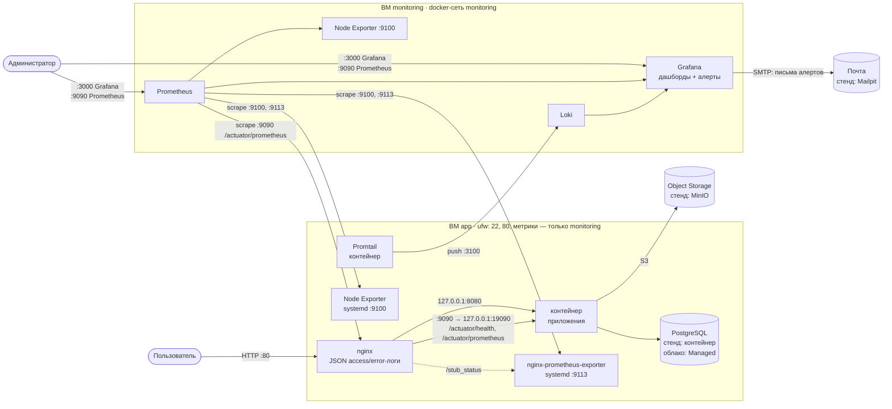
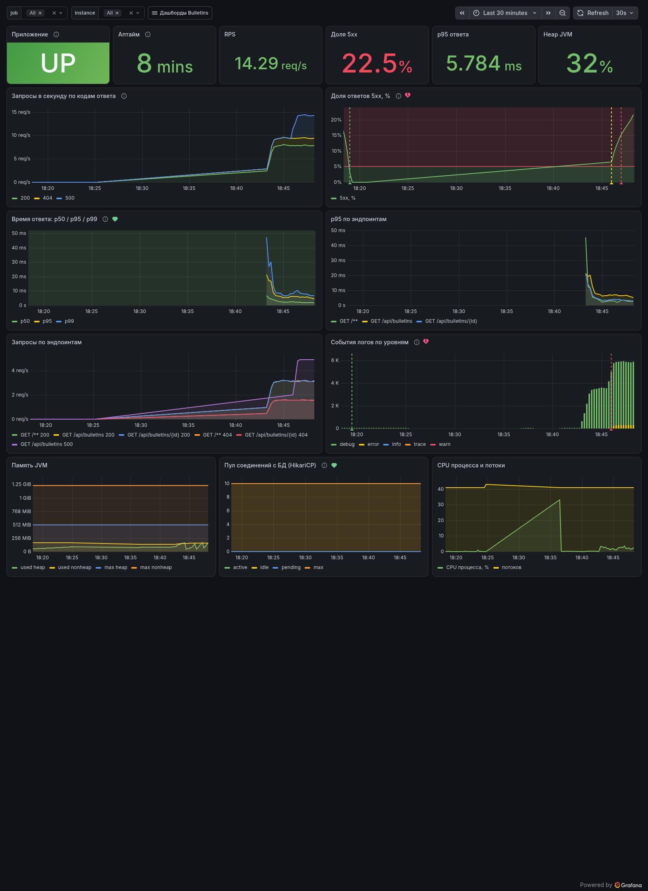
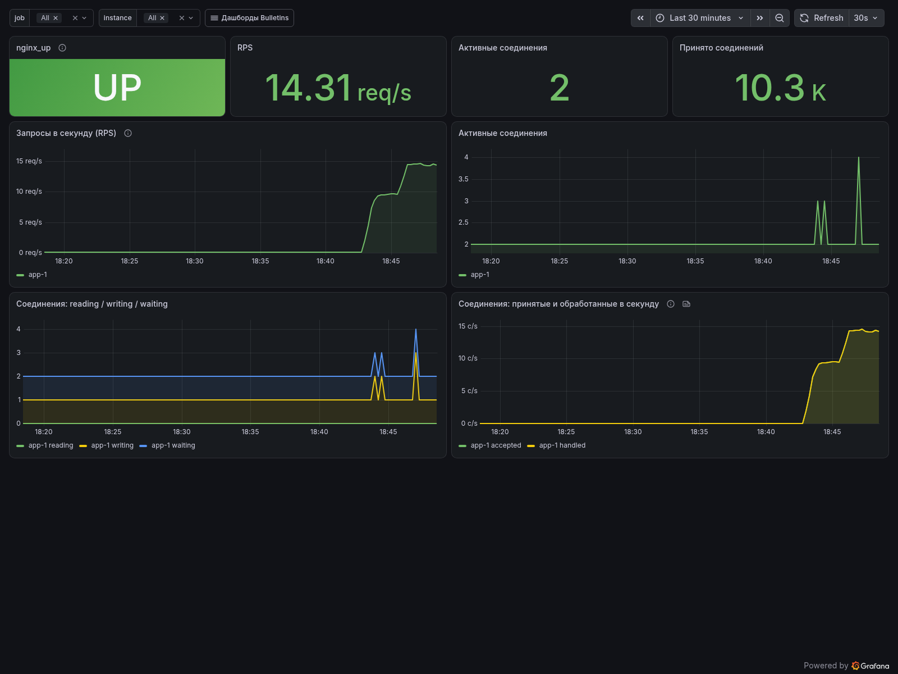
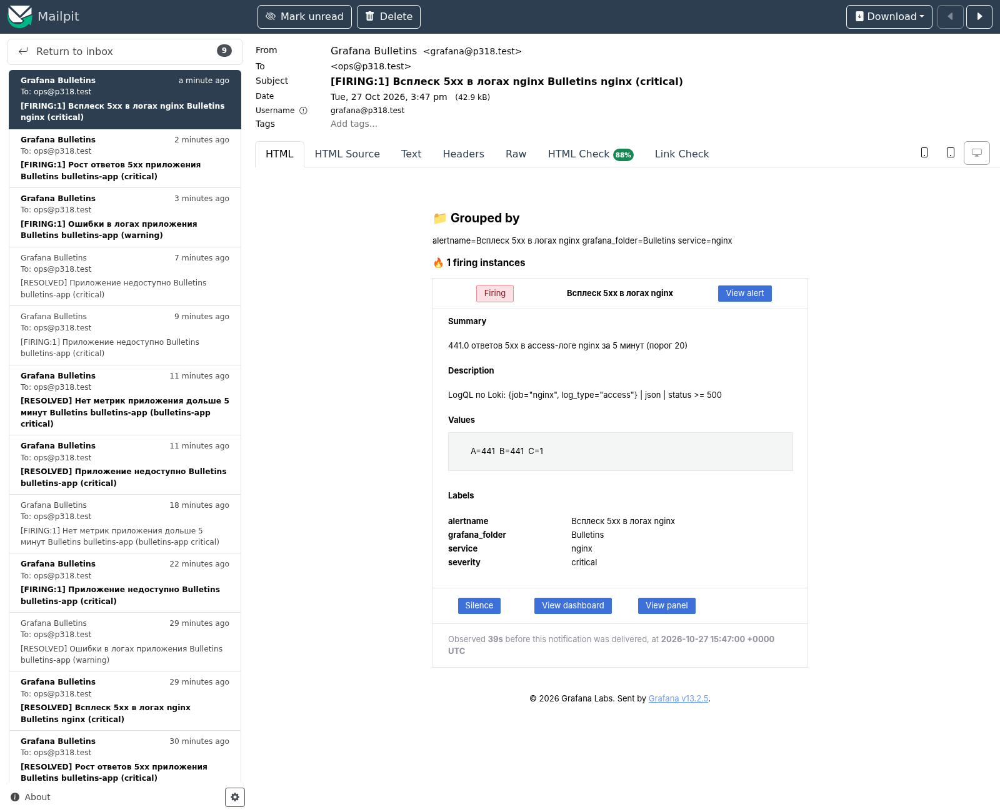

# Доска объявлений (Observability)

[](https://github.com/kicha3007-boop/devops-engineer-from-scratch-project-318/actions)
[](https://github.com/kicha3007-boop/devops-engineer-from-scratch-project-318/actions/workflows/ci.yml)

Наблюдаемость приложения «Доска объявлений» (Spring Boot + PostgreSQL + S3): две ВМ, описанные
кодом. На ВМ **app** — приложение в Docker, nginx с JSON-логами, Node Exporter,
nginx-prometheus-exporter и Promtail; на ВМ **monitoring** — Prometheus, Grafana (дашборды,
алерты на почту) и Loki. Всё ставится Ansible-плейбуками из `ansible/playbooks` одной командой
`make deploy`, облачные ресурсы (ВМ, сеть, группы безопасности, Managed PostgreSQL, Object
Storage) описаны в Terraform.

Учебный проект Хекслета: https://ru.hexlet.io/programs/devops-engineer-from-scratch

> **Облачный стенд не разворачивался**: у автора нет аккаунта Yandex Cloud, ВМ и домена.
> Всё, что нужно для облака, описано в коде (`terraform/` + `ansible/inventories/production`,
> раздел [«Развёртывание с нуля в Yandex Cloud»](#развёртывание-с-нуля-в-yandex-cloud)), а
> проверено на **локальном стенде**, который повторяет обе ВМ: «ВМ» — контейнеры Ubuntu 24.04 с
> systemd и sshd, плейбуки те же, отличаются только значения в `ansible/inventories/lab`.
> Все результаты ниже (таргеты, дашборды, письма алертов) получены на этом стенде.

## Содержание

- [Схема](#схема)
- [Что проверено](#что-проверено)
- [Шаги задания и где они сделаны](#шаги-задания-и-где-они-сделаны)
- [Порты, адреса и каналы оповещений](#порты-адреса-и-каналы-оповещений)
- [Метрики](#метрики)
- [Prometheus](#prometheus)
- [Grafana и дашборды](#grafana-и-дашборды)
- [Алертинг](#алертинг)
- [Логи: Promtail и Loki](#логи-promtail-и-loki)
- [Локальный стенд](#локальный-стенд)
- [Развёртывание с нуля в Yandex Cloud](#развёртывание-с-нуля-в-yandex-cloud)
- [Переменные и секреты](#переменные-и-секреты)
- [Команды Makefile](#команды-makefile)
- [Приложение, Docker-образ и CI](#приложение-docker-образ-и-ci)

## Схема



Потоки данных:

- **Prometheus ← метрики**: Actuator приложения (через nginx на management-порту 9090), Node Exporter
  обеих ВМ, nginx-prometheus-exporter, а также собственные метрики Prometheus, Grafana и Loki.
- **Loki ← логи**: Promtail читает JSON access-лог и error-лог nginx и stdout контейнеров
  (приложение пишет JSON) и отправляет их по внутренней сети.
- **Grafana**: datasource'ы Prometheus и Loki, 5 дашбордов и 12 правил алертинга из provisioning.
- **Alerting → почта**: contact point email через SMTP (облако — Яндекс Почта, стенд — Mailpit).

## Что проверено

Всё на локальном стенде (`make lab-up && make lab-deploy`), команды и их вывод:

- **С нуля** (`make lab-down && make lab-up && make lab-deploy`, образ `latest` из GHCR, собранный CI):
  первый прогон — `app-1: ok=71 changed=46 failed=0`, повторный `make lab-deploy` —
  `app-1: ok=58 changed=0`, `monitoring-1: ok=54 changed=0`. (Первые попытки обрывались на 502 от
  `archive.ubuntu.com` при установке Docker — это сбой зеркала, повторный запуск продолжает с места.)
- **`make lab-test`** (ping, сервисы, контейнеры, эндпоинты, promtool, таргеты, Loki, Grafana) — `failed=0`,
  в том числе после `make lab-reboot` (обе «ВМ» перезагружены, всё поднялось само). Выдержки:

  ```text
  promtool: SUCCESS: /etc/prometheus/prometheus.yml is valid prometheus config file syntax
            SUCCESS: 11 rules found (/etc/prometheus/rules/alerts.yml)
  дашборды: Nginx, Status Page, Логи (Loki), Приложение (Bulletins), Система (Node Exporter);
  правил алертинга: 12; contact point: email-ops
  ```

- **Все таргеты `up == 1`** — `make lab-smoke` (вывод `/api/v1/targets`), скриншот
  [`prometheus-targets.png`](assets/prometheus-targets.png):

  ```text
  Приложение: http://10.38.0.10
    [ok]   главная страница: 200
    [ok]   REST /api/bulletins: 200
    [ok]   actuator на публичном порту закрыт: 404
    [ok]   management-порт 9090 закрыт для этого адреса (firewall)
  Prometheus: http://10.38.0.20:9090
    [ok]   /-/healthy: 200
           up   bulletins-app  http://10.38.0.10:9090/actuator/prometheus
           up   grafana        http://grafana:3000/metrics
           up   loki           http://loki:3100/metrics
           up   nginx          http://10.38.0.10:9113/metrics
           up   node           http://10.38.0.10:9100/metrics
           up   node           http://10.38.0.20:9100/metrics
           up   prometheus     http://localhost:9090/metrics
    [ok]   все таргеты up: 7 шт.
    [ok]   правил алертинга Prometheus: 11
  Grafana: http://10.38.0.20:3000
    [ok]   /api/health: {"database":"ok","version":"13.2.5",...}
  Smoke-тесты пройдены
  ```

- **Логи end-to-end** — `make lab-logs-e2e`: строка с меткой из access-лога nginx найдена через
  datasource Loki в Grafana с лейблами `job=nginx`, `env=lab`, `app=bulletins`, `host=app-1`,
  `log_type=access`:

  ```text
  query: '{job="nginx", log_type="access"} |= "e2e-1793113546710553002"'
  line: '{"time":"2026-10-27T15:05:47+00:00","remote_addr":"127.0.0.1",...,"request_method":"GET",
         "uri":"/e2e-log-check/e2e-1793113546710553002",...,"status":404,...,"request_time":0.010,...}'
  ```

- **Алерты и письма** — `make lab-alert-test` (поток 5xx) и `make lab-alert-test SCENARIO=app-down`,
  письма — `make lab-mail`:

  ```text
  15:11:30  [FIRING:1] Рост ответов 5xx приложения Bulletins bulletins-app (critical)
  15:11:32  [FIRING:1] Ошибки в логах приложения Bulletins bulletins-app (warning)
  15:11:38  [FIRING:1] Всплеск 5xx в логах nginx Bulletins nginx (critical)
  15:19:30  [RESOLVED] Рост ответов 5xx приложения Bulletins bulletins-app (critical)
  15:19:38  [RESOLVED] Всплеск 5xx в логах nginx Bulletins nginx (critical)
  15:39:40  [FIRING:1] Приложение недоступно Bulletins bulletins-app (critical)
  15:41:40  [RESOLVED] Приложение недоступно Bulletins bulletins-app (critical)
  ```

  Скриншоты: [сработавшие алерты](assets/grafana-alerts-firing.png),
  [Status Page](assets/grafana-status.png), [входящие Mailpit](assets/mailpit-inbox.png),
  [письмо FIRING](assets/mailpit-firing-email.png), [письмо RESOLVED](assets/mailpit-resolved-email.png),
  [алерты Prometheus](assets/prometheus-alerts.png).
- **Линтеры**: `make lint` — `Passed: 0 failure(s), 0 warning(s)` (ansible-lint, профиль production),
  `terraform fmt -check`, JSON дашбордов; `terraform validate` — `Success! The configuration is valid.`
- **Автопроверка Хекслета** локально (образ `hexletprojects/devops_bulletin_board_observability_project_ru`,
  пустые списки apt): `make setup` → `make test` — `All tests passed`, `make lint` — `Passed`.

Скриншоты всех дашбордов — в [`assets/`](assets) (`make lab-screenshots`).

## Шаги задания и где они сделаны

| Шаг | Где сделано |
|---|---|
| 1. Приложение, образ, CI, базовая инфраструктура | код из [Hexlet-components/project-devops-deploy](https://github.com/Hexlet-components/project-devops-deploy) (через проект 315: Flyway, `Dockerfile`); [`ci.yml`](.github/workflows/ci.yml) — тесты, линтеры, образ в GHCR; [`terraform/`](terraform) — ВМ, сеть, Managed PostgreSQL, Object Storage; [`playbooks/app.yml`](ansible/playbooks/app.yml) — Docker, ufw, приложение |
| 2. Node Exporter и метрики приложения | роль [`node_exporter`](ansible/roles/node_exporter) (бинарник + systemd, `Restart=always`, коллектор systemd); Actuator `/actuator/prometheus` на management-порту 9090 через nginx ([`metrics.conf.j2`](ansible/roles/nginx/templates/metrics.conf.j2)); JSON-логи nginx ([`site.conf.j2`](ansible/roles/nginx/templates/site.conf.j2)); [таблица метрик](#метрики) |
| 3. Prometheus | роль [`prometheus`](ansible/roles/prometheus): контейнер, тома для конфига и данных, таргеты из `prometheus_scrape_jobs` в [`group_vars/monitoring.yml`](ansible/group_vars/monitoring.yml), правила [`alerts.yml.j2`](ansible/roles/prometheus/templates/alerts.yml.j2), проверка `promtool check config` при каждом деплое |
| 4. Grafana | роль [`grafana`](ansible/roles/grafana): контейнер, provisioning datasource'ов Prometheus и Loki, дашборды JSON в [`files/dashboards`](ansible/roles/grafana/files/dashboards), переменные `$job`/`$instance` |
| 5. Алертинг | [`alerting/rules.yml.j2`](ansible/roles/grafana/templates/alerting/rules.yml.j2) (12 правил, `for`, лейблы `service`/`severity`), contact point email, политика уведомлений; [проверка](#как-задёргать-алерт) |
| 6. nginx-prometheus-exporter | `stub_status` на management-порту с allow-list; роль [`nginx_exporter`](ansible/roles/nginx_exporter) (systemd); job `nginx`; дашборд «Nginx» |
| 7. Promtail + Loki | роли [`promtail`](ansible/roles/promtail) (контейнер, лейблы `job/env/app/host`, pipeline для JSON nginx и приложения) и [`loki`](ansible/roles/loki); дашборд «Логи», алерт по логам, [e2e-проверка](#проверка-доставки-логов) |
| 8. Проверки и документация | `make lint` (ansible-lint, terraform fmt, JSON), `make test` (ping + [`test.yml`](ansible/playbooks/test.yml)), `make smoke` ([`scripts/smoke.sh`](scripts/smoke.sh)); этот README; скриншоты в [`assets/`](assets) |

### Структура репозитория

```text
.
├── ansible
│   ├── ansible.cfg
│   ├── group_vars           # общие для облака и стенда: таргеты, пороги алертов, порты
│   ├── inventories
│   │   ├── production       # облако: hosts.ini, host_vars, group_vars/all (vars + vault)
│   │   ├── lab              # локальный стенд
│   │   └── vault.yml.example
│   ├── playbooks            # site.yml = monitoring.yml + app.yml; test, logs-e2e, alert-test
│   └── roles                # common, docker_access, firewall, node_exporter, postgres, app,
│                            # nginx, nginx_exporter, promtail, loki, prometheus, grafana
├── assets                   # скриншоты дашбордов, таргетов, алертов и писем
├── lab                      # локальный стенд: compose, образ «ВМ», toolbox, скрипты
├── scripts/smoke.sh
├── terraform                # Yandex Cloud: 2 ВМ, сеть, группы безопасности, PostgreSQL, S3
├── src, frontend, Dockerfile, build.gradle.kts   # приложение
├── Makefile
├── README.md
└── requirements.yml         # geerlingguy.docker, community.docker, community.general
```

Общие переменные лежат в `ansible/group_vars/{all,app,monitoring}.yml` и подключаются в плейбуках
через `vars_files` (каталог не рядом с инвентарём, поэтому Ansible сам его не читает); отличия
окружений — в `ansible/inventories/<окружение>/group_vars/all/vars.yml`, секреты — в `vault.yml`
рядом. Имена переменных в этих местах не пересекаются.

## Порты, адреса и каналы оповещений

| Что | Облако (production) | Локальный стенд |
|---|---|---|
| Приложение | `http://bulletins.example.ru` (`app_domain`, A-запись → `app_public_ip`) | http://localhost:38080 |
| Grafana | `http://<monitoring_public_ip>:3000`, логин `admin`, пароль — `vault_grafana_admin_password` | http://localhost:38030, `admin` / `make vault-view ENV=lab` |
| Prometheus (`/graph`, `/targets`, `/alerts`) | `http://<monitoring_public_ip>:9090` (только с `admin_cidrs`) | http://localhost:38090 |
| Loki (`/ready`, push API) | `http://<monitoring_private_ip>:3100` — только из внутренней сети, с ВМ app | http://localhost:38100/ready |
| Actuator и `stub_status` | `http://<app_private_ip>:9090/actuator/health`, `/actuator/prometheus`, `/stub_status` — только с ВМ monitoring | изнутри стенда: `http://10.38.0.10:9090/...` с «ВМ» monitoring |
| Node Exporter | `<ip>:9100` обеих ВМ — только с ВМ monitoring | `10.38.0.10:9100`, `10.38.0.20:9100` |
| nginx-prometheus-exporter | `<app_private_ip>:9113` — только с ВМ monitoring | `10.38.0.10:9113` |
| Почта алертов | SMTP `smtp.yandex.ru:587` (STARTTLS, пароль приложения), получатель `vault_alert_email_to` | Mailpit: http://localhost:38025 (SMTP `mailpit.p318.test:1025`, STARTTLS), получатель `ops@p318.test` |
| Внутренняя сеть | `10.10.0.0/24`: app `10.10.0.10`, monitoring `10.10.0.20` | `10.38.0.0/24`: app `10.38.0.10`, monitoring `10.38.0.20` |
| SSH | 22 обеих ВМ, только с `admin_cidrs` | `make lab-ssh-app`, `make lab-ssh-monitoring` |

Каналы оповещений: только почта (встроенный contact point Grafana `email-ops`). ntfy и Telegram
не настраивались.

Что и чем закрыто:

- **ВМ app**: ufw — наружу 22 и 80; 9090/9100/9113 — только с адреса ВМ monitoring
  (`firewall_restricted_tcp_ports` в [`group_vars/app.yml`](ansible/group_vars/app.yml)). Порты
  приложения опубликованы Docker только на `127.0.0.1` (8080 и 19090). Второй слой — `allow`/`deny`
  в nginx на management-порту и группа безопасности `bulletins-app` в Terraform.
- **ВМ monitoring**: ufw — наружу 22, а 9100 — только из docker-сети `monitoring`. Порты контейнеров
  Grafana/Prometheus/Loki Docker публикует в обход ufw, поэтому снаружи их ограничивает группа
  безопасности `bulletins-monitoring`: 3000 и 9090 — только `admin_cidrs`, 3100 — только ВМ app.
  На локальном стенде этой группы безопасности нет — стенд доступен только с `127.0.0.1` хоста.

## Метрики

Обязательные метрики, которые должны быть в Prometheus (все проверены запросами к стенду):

| Метрика | Источник (job) | Что показывает | Где используется |
|---|---|---|---|
| `up` | все | таргет отвечает (1) или нет (0) | Status Page, алерты «Приложение недоступно», «Таргет недоступен» |
| `node_load1`, `node_load5`, `node_load15` | node | средняя загрузка | дашборд «Система» |
| `node_cpu_seconds_total` | node | время CPU по режимам → загрузка, % | «Система», алерт CPU |
| `node_memory_MemAvailable_bytes`, `node_memory_MemTotal_bytes` | node | доступная и общая память | «Система», алерт памяти |
| `node_filesystem_avail_bytes`, `node_filesystem_size_bytes` | node | место на дисках | «Система», алерт диска |
| `node_disk_read_bytes_total`, `node_disk_written_bytes_total` | node | дисковый ввод-вывод | «Система» |
| `node_network_receive_bytes_total`, `node_network_transmit_bytes_total` | node | сетевой трафик | «Система» |
| `node_procs_running`, `node_procs_blocked`, `node_processes_state` | node | процессы | «Система» |
| `node_systemd_unit_state` | node | состояние docker, nginx, ssh, ufw и экспортеров | «Система» |
| `node_boot_time_seconds` | node | аптайм ВМ | «Система» |
| `http_server_requests_seconds_count` (лейблы `status`, `uri`, `method`) | bulletins-app | число запросов по кодам ответа | «Приложение», алерт 5xx |
| `http_server_requests_seconds_bucket` | bulletins-app | гистограмма времени ответа → p50/p95/p99 | «Приложение», алерт p95 |
| `process_uptime_seconds` | bulletins-app | аптайм JVM | «Приложение», алерт «нет метрик N минут» |
| `logback_events_total` (лейбл `level`) | bulletins-app | события логов по уровням | «Приложение», алерт ошибок в логах |
| `hikaricp_connections_active`, `_idle`, `_pending`, `_max` | bulletins-app | пул соединений с БД | «Приложение», алерт пула |
| `jvm_memory_used_bytes`, `jvm_memory_max_bytes`, `jvm_threads_live_threads`, `process_cpu_usage` | bulletins-app | память JVM, потоки, CPU процесса | «Приложение» |
| `nginx_up` | nginx | экспортер читает `stub_status` | «Nginx», алерт |
| `nginx_http_requests_total` | nginx | всего запросов → RPS | «Nginx» |
| `nginx_connections_active`, `_reading`, `_writing`, `_waiting`, `_accepted`, `_handled` | nginx | соединения nginx | «Nginx» |

Почему коды ответов и latency — из метрик приложения: открытый nginx через `stub_status` отдаёт
только счётчики соединений и общее число запросов, разбивки по `1xx`–`5xx` и времени ответа там
нет (она есть только в NGINX Plus). Дополнительно коды и время ответа nginx видны в логах через
Loki (поля `status` и `request_time` JSON-лога).

### Проверка эндпоинтов curl

С ВМ monitoring (на стенде: `make lab-ssh-monitoring`), подставив `private_ip` ВМ app:

```bash
curl -s http://10.38.0.10:9090/actuator/health                 # {"status":"UP",...}
curl -s http://10.38.0.10:9090/actuator/prometheus | grep -E '^(http_server_requests_seconds_count|process_uptime_seconds|logback_events_total)' | head
curl -s http://10.38.0.10:9090/stub_status                      # Active connections: ...
curl -s http://10.38.0.10:9113/metrics | grep -E '^nginx_(up|http_requests_total|connections_active)'
curl -s http://10.38.0.10:9100/metrics | grep -E '^node_load1'
curl -s 'http://localhost:9090/api/v1/targets?state=active' | jq -r '.data.activeTargets[] | "\(.health) \(.labels.job) \(.scrapeUrl)"'
curl -s http://localhost:3100/ready                              # ready
```

С любого другого адреса management-порт закрыт: ufw отбрасывает соединение (если ufw выключен —
nginx отвечает 403), а на публичном порту 80 путь `/actuator/*` отдаёт 404:

```bash
curl -s -o /dev/null -w '%{http_code}\n' http://localhost:38080/actuator/prometheus   # 404
```

## Prometheus

- Конфиг [`prometheus.yml.j2`](ansible/roles/prometheus/templates/prometheus.yml.j2) строится из
  переменной `prometheus_scrape_jobs` ([`group_vars/monitoring.yml`](ansible/group_vars/monitoring.yml)):
  `hosts` — группы инвентаря (адрес — `private_ip` хоста), `static` — адреса внутри docker-сети.
  Добавить сервис — дописать элемент в список и выполнить `make prometheus-config`.
- Job `bulletins-app` — `metrics_path: /actuator/prometheus`; jobs `node`, `nginx`, `prometheus`,
  `grafana`, `loki`. У каждого таргета лейбл `host` (имя ВМ из инвентаря).
- Перед применением конфиг проверяется `promtool check config` (вместе с правилами), затем
  Prometheus перечитывает его через `POST /-/reload`, без перезапуска.
- Правила Prometheus ([`alerts.yml.j2`](ansible/roles/prometheus/templates/alerts.yml.j2)) видны на
  `/alerts`; письма по тем же условиям отправляет Grafana Alerting.
- Конфиг и правила — каталог `/opt/prometheus` на ВМ (монтируется только для чтения), данные — том
  `prometheus-data`, срок хранения `prometheus_retention_time` (15 дней).

Проверка `up == 1` для всех таргетов: `make test` (задача «Все таргеты Prometheus в состоянии up»),
`make smoke` или запрос `up` на `/graph`. Вывод `/api/v1/targets` со стенда — в разделе
[«Что проверено»](#что-проверено), скриншот — [`assets/prometheus-targets.png`](assets/prometheus-targets.png).

## Grafana и дашборды

- URL и логин — в [таблице портов](#порты-адреса-и-каналы-оповещений). Пароль администратора
  берётся из Vault при первом запуске Grafana (`GF_SECURITY_ADMIN_PASSWORD`); регистрация и
  анонимный доступ выключены.
- Datasource'ы Prometheus (`uid: prometheus`) и Loki (`uid: loki`) —
  [`datasources.yml.j2`](ansible/roles/grafana/templates/datasources/datasources.yml.j2).
- Дашборды — JSON в [`ansible/roles/grafana/files/dashboards`](ansible/roles/grafana/files/dashboards),
  папка `Bulletins`. Правки через UI не сохраняются: дашборд меняется в репозитории.
- **Обновить дашборды и алерты: `make dashboards`** (роль `grafana` целиком: datasource'ы,
  дашборды, contact point, политика и правила алертинга).

| Дашборд | uid | Что на нём | Скриншот |
|---|---|---|---|
| Приложение (Bulletins) | `bulletins-app` | доступность, RPS по кодам, доля 5xx, p50/p95/p99 и p95 по эндпоинтам, события логов, JVM, пул БД; переменные `$job`, `$instance` | [grafana-app.png](assets/grafana-app.png) |
| Система (Node Exporter) | `bulletins-node` | CPU, load average, память, диск, IO, сеть, процессы, аптайм, systemd-сервисы; `$job`, `$instance` | [grafana-node.png](assets/grafana-node.png) |
| Nginx | `bulletins-nginx` | `nginx_up`, RPS `rate(nginx_http_requests_total[1m])`, активные соединения, reading/writing/waiting, accepted/handled; `$job`, `$instance` | [grafana-nginx.png](assets/grafana-nginx.png) |
| Логи (Loki) | `bulletins-logs` | 5xx по логам nginx, p95 `request_time` по URI, ошибки приложения, поиск по IP клиента и тексту | [grafana-logs.png](assets/grafana-logs.png) |
| Status Page | `bulletins-status` | `up` всех таргетов, приложение, nginx, доставка логов, список алертов | [grafana-status.png](assets/grafana-status.png) |





## Алертинг

Правила Grafana Alerting — [`alerting/rules.yml.j2`](ansible/roles/grafana/templates/alerting/rules.yml.j2),
пороги — переменные `alert_*` в [`group_vars/monitoring.yml`](ansible/group_vars/monitoring.yml).
Каждое правило: запрос → последнее значение → порог; `for` защищает от кратких всплесков, лейблы
`service` и `severity` определяют маршрут уведомления; правило связано с панелью дашборда.

| Правило | Запрос (кратко) | Порог (переменная) | for | severity |
|---|---|---|---|---|
| Приложение недоступно | `max(up{job="bulletins-app"})` (нет данных — тоже алерт) | < 1 | 1m | critical |
| Таргет Prometheus недоступен | `up{job!="bulletins-app"}` | < 1 | 1m | critical |
| Нет метрик приложения дольше 5 минут | `absent_over_time(process_uptime_seconds[5m])` | `alert_no_data_minutes` | — | critical |
| Nginx не отдаёт stub_status | `nginx_up` | < 1 | 1m | critical |
| Рост ответов 5xx приложения | доля `http_server_requests_seconds_count{status=~"5.."}`, % (и не меньше `alert_5xx_min_rps` в секунду) | `alert_5xx_ratio_percent` = 5 | 1m | critical |
| Всплеск 5xx в логах nginx (Loki) | `sum(count_over_time({job="nginx",log_type="access"} \| json \| status >= 500 [5m]))` | `alert_5xx_log_lines` = 20 | 1m | critical |
| Медленные ответы приложения (p95) | `histogram_quantile(0.95, …http_server_requests_seconds_bucket…)` | `alert_latency_p95_seconds` = 1 | 5m | warning |
| Ошибки в логах приложения | `sum(increase(logback_events_total{level="error"}[5m]))` | `alert_app_errors_5m` = 10 | — | warning |
| Пул соединений с БД исчерпан | `hikaricp_connections_active / hikaricp_connections_max` | `alert_db_pool_percent` = 90 | 5m | warning |
| Высокая загрузка CPU | `100 - avg by (host)(rate(node_cpu_seconds_total{mode="idle"}[5m]))*100` | `alert_cpu_percent` = 85 | 5m | warning |
| Мало свободной памяти | `(1 - MemAvailable/MemTotal)*100` | `alert_memory_percent` = 90 | 5m | warning |
| Заканчивается место на диске | `(1 - avail/size{mountpoint="/"})*100` | `alert_disk_percent` = 85 | 5m | warning |

Падение контейнера приложения ловит «Приложение недоступно»: nginx отвечает 502 на
`/actuator/prometheus`, и `up` таргета становится 0.

**Contact point** `email-ops` ([`contact-points.yml.j2`](ansible/roles/grafana/templates/alerting/contact-points.yml.j2)):
письма через SMTP, настройки сервера — переменные `grafana_smtp_*`, пароль — `vault_smtp_password`
в Vault, получатель — `grafana_alert_email_to`. Политика ([`policies.yml.j2`](ansible/roles/grafana/templates/alerting/policies.yml.j2))
группирует по `alertname` и `service`; critical повторяются раз в час, warning — раз в 12 часов.
Для облака: в Яндекс ID создать пароль приложения для почты и положить его в `vault_smtp_password`,
адрес — в `vault_smtp_user`.

Где смотреть правила: Grafana → Alerting → Alert rules (папка `Bulletins`), Prometheus → `/alerts`,
API: `GET /api/v1/provisioning/alert-rules`.

### Как задёргать алерт

```bash
make alert-test SCENARIO=errors      # 3 минуты по 5 запросов/с, на которые приложение отвечает 500
                                     # (GET /api/bulletins?sort=noSuchField)
make alert-test SCENARIO=app-down    # остановить контейнер приложения на 3 минуты и запустить снова
# на стенде — то же с префиксом lab-: make lab-alert-test [SCENARIO=app-down]; письма: make lab-mail
```

Через 1–2 минуты правило переходит `Pending → Firing`, Grafana отправляет письмо; после окончания
сценария приходит письмо `RESOLVED`. Результат со стенда — в [«Что проверено»](#что-проверено) и
на скриншотах: [список сработавших алертов](assets/grafana-alerts-firing.png),
[входящие Mailpit](assets/mailpit-inbox.png), [письмо алерта](assets/mailpit-firing-email.png), [письмо о восстановлении](assets/mailpit-resolved-email.png).



## Логи: Promtail и Loki

- **Promtail** — контейнер на ВМ app ([роль `promtail`](ansible/roles/promtail), конфиг
  [`config.yml.j2`](ansible/roles/promtail/templates/config.yml.j2)), `restart_policy: unless-stopped`.
  Собирает только нужное, а не весь `/var/log`:
  - `job="nginx"` — файлы `/var/log/nginx/bulletins.access.log` (JSON, `log_type="access"`) и
    `bulletins.error.log` (`log_type="error"`, строка разбирается регулярным выражением: формат
    error_log в nginx не настраивается);
  - контейнеры с меткой `logging=promtail` через `docker_sd_configs`: приложение
    (`job="bulletins-app"`, JSON logstash-logback-encoder → лейбл `level`, время события) и PostgreSQL
    (`job="postgres"`).
  - Лейблы всех записей: `job`, `env` (`production`/`lab`), `app` (`bulletins`), `host` (имя ВМ),
    плюс `log_type`, `method`, `container`, `level`.
- **Loki** — контейнер на ВМ monitoring ([роль `loki`](ansible/roles/loki)), хранение TSDB на томе
  `loki-data`, срок хранения `loki_retention_period` (7 дней). Порт 3100 — только для ВМ app.
- Секретов у Promtail и Loki нет: доступ к Loki ограничен сетью (группа безопасности).

Сохранённые LogQL-запросы — панели дашборда «Логи (Loki)»:

| Что ищем | LogQL |
|---|---|
| Ошибки 5xx в access-логе nginx | `{job="nginx", log_type="access"} \| json \| status >= 500` |
| Число 5xx в минуту по кодам | `sum by (status) (count_over_time({job="nginx", log_type="access"} \| json \| status >= 500 [1m]))` |
| Ошибки приложения | `{job="bulletins-app", level=~"ERROR\|WARN"}` |
| Время ответа (latency) p95 по URI | `quantile_over_time(0.95, {job="nginx", log_type="access"} \| json \| __error__="" \| unwrap request_time [5m]) by (uri)` |
| Поиск по пользователю (IP клиента) | `{job="nginx", log_type="access"} \| json \| remote_addr=~"$client.*"` |
| Поиск по тексту в логах приложения | `{job="bulletins-app"} \|= "$search"` |
| Error-лог nginx и PostgreSQL | `{job=~"nginx\|postgres", log_type!="access"}` |

### Проверка доставки логов

```bash
make logs-e2e        # на стенде: make lab-logs-e2e
```

Плейбук [`logs-e2e.yml`](ansible/playbooks/logs-e2e.yml) делает запрос с уникальной меткой в URL
к приложению через nginx, затем ищет эту строку LogQL-запросом через datasource Loki в Grafana
(`/api/datasources/proxy/uid/loki/loki/api/v1/query_range`) и печатает найденную запись с лейблами.
Вручную: Grafana → Explore → Loki → `{job="nginx"} |= "<метка>"`.

## Локальный стенд

Повторяет облако: две «ВМ» — контейнеры `p318-app` и `p318-monitoring` с чистой Ubuntu 24.04,
systemd и sshd в общей сети `p318-lab` (`10.38.0.0/24`, аналог внутренней сети облака). Плейбуки
ставят на них Docker, ufw, nginx, экспортеры, Prometheus, Grafana и Loki так же, как на настоящие ВМ.
Облачные сервисы заменены локальными: Object Storage → MinIO (`p318-minio`), Managed PostgreSQL →
контейнер PostgreSQL на «ВМ» app (`postgres_enabled: true`), почта → Mailpit (`p318-mailpit`).
Для скриншотов — `p318-renderer` (grafana-image-renderer). Нужен только Docker (и `make`).

```bash
make lab-up            # образы стенда, секреты (Vault), «ВМ», MinIO, Mailpit, роли из requirements.yml, бакет
make lab-deploy        # ansible/playbooks/site.yml на обе «ВМ» (повторный запуск: changed=0)
make lab-test          # ping + проверки сервисов, таргетов, Loki и Grafana
make lab-smoke         # curl к приложению, Prometheus и Grafana
make lab-logs-e2e      # тестовая строка лога доходит до Loki и видна через Grafana
make lab-alert-test    # поток 5xx → алерты → письма в Mailpit; SCENARIO=app-down — падение приложения
make lab-mail          # письма в Mailpit (или http://localhost:38025)
make lab-screenshots   # скриншоты в assets/
make lab-down          # удалить стенд вместе с томами
```

До первой сборки образа в CI (или чтобы проверить текущий код без реестра) — `make lab-image`:
собирает образ локально, загружает его в «ВМ» app и выкатывает. Если в системе настроен HTTP-прокси,
запросы к стенду делайте мимо него: `curl --noproxy '*' http://localhost:38080/`.

Чем стенд отличается от облака — честно:

- «ВМ» — привилегированные контейнеры (нужно для systemd, Docker внутри и iptables). ufw в них
  работает по-настоящему, но групп безопасности нет; порты на хост пробрасывает Docker Desktop
  только на `127.0.0.1`.
- БД — контейнер на «ВМ» app вместо Managed PostgreSQL; бакет MinIO создаёт
  [`playbooks/lab-s3.yml`](ansible/playbooks/lab-s3.yml) вместо Terraform.
- Письма уходят в Mailpit, а не в настоящий почтовый ящик. Как и настоящий сервер, Mailpit требует
  STARTTLS и вход по паролю (Grafana передаёт пароль из Vault), но сертификат у него самоподписанный,
  поэтому на стенде `grafana_smtp_skip_verify: true`, а Mailpit принимает любой пароль.
- Образы Docker Hub «ВМ» тянут через зеркало `mirror.gcr.io` (Docker Hub из РФ часто недоступен).

## Развёртывание с нуля в Yandex Cloud

Не выполнялось (нет облачного аккаунта); `terraform validate`, `ansible-lint` и синтаксис плейбуков
проверяются в CI.

1. **Ключи и репозиторий.** Форк репозитория, SSH-ключ: `ssh-keygen -t ed25519` (публичная часть —
   в `terraform.tfvars`, приватная — в `~/.ssh`, Ansible берёт её из `SSH_KEYS_DIR`).
2. **Инструменты:** `make setup` — собрать toolbox (Ansible, ansible-lint, Terraform) и поставить
   роли/коллекции из `requirements.yml`. Нужен только Docker.
3. **Облако (Terraform).** Каталог в Yandex Cloud, OAuth/IAM-токен, затем:

    ```bash
    cp terraform/terraform.tfvars.example terraform/terraform.tfvars   # folder_id, ssh_public_key, admin_cidrs
    export YC_TOKEN=... YC_CLOUD_ID=... TF_VAR_db_password='длинный-пароль-БД'
    make tf-init tf-plan tf-apply     # 2 ВМ, сеть, группы безопасности, PostgreSQL, бакет, сервисные аккаунты
    make tf-output                    # app_public_ip, app_private_ip, monitoring_*, db_host, bucket_name, app_access_key
    docker compose -f lab/compose.yaml run --rm toolbox terraform -chdir=../terraform output -raw app_secret_key
    ```

    Провайдер скачивается через зеркало `terraform-mirror.yandexcloud.net`
    ([`lab/toolbox/terraformrc`](lab/toolbox/terraformrc)), состояние — локально в `terraform/terraform.tfstate`
    (в `.gitignore`).
4. **Домен:** A-запись `bulletins.<домен>` → `app_public_ip` (или `dns_zone` в `terraform.tfvars`,
   если домен делегирован в Yandex Cloud); имя — в `app_domain`
   ([`inventories/production/group_vars/all/vars.yml`](ansible/inventories/production/group_vars/all/vars.yml)).
   Проверка: `dig +short bulletins.<домен>`.
5. **Секреты (Ansible Vault):**

    ```bash
    echo 'длинный-пароль' > .vault_pass                     # в git не попадает
    cp ansible/inventories/vault.yml.example ansible/inventories/production/group_vars/all/vault.yml
    # заполнить: адреса из terraform output, пароль БД, ключи S3, пароль Grafana, SMTP, admin_cidrs
    make vault-encrypt                                       # править потом: make vault-edit
    ```

    Зашифрованный `vault.yml` в репозитории содержит заглушки — замените его своим.
6. **Деплой обеих ВМ:** `make deploy SSH_KEYS_DIR=~/.ssh` (сначала monitoring, затем app).
   По отдельности — `make deploy-monitoring`, `make deploy-app`. Повторный запуск ничего не меняет.
7. **Проверка:** `make test` (ping, сервисы, все таргеты `up`, Loki, Grafana), затем
   `make smoke APP_URL=http://bulletins.<домен> PROMETHEUS_URL=http://<monitoring_public_ip>:9090 GRAFANA_URL=http://<monitoring_public_ip>:3000`,
   `make logs-e2e`, `make alert-test` — письмо должно прийти на `vault_alert_email_to`.
8. **Обновление:** приложение — `make deploy-app TAGS=app` (откат: `TAG=<git sha>`), дашборды и
   алерты — `make dashboards`, таргеты Prometheus — `make prometheus-config`.

## Переменные и секреты

Главные переменные окружения (файл `inventories/<окружение>/group_vars/all/vars.yml`):

| Переменная | Назначение |
|---|---|
| `env_name` | лейбл `env` в логах и `external_labels` Prometheus |
| `app_domain`, `app_public_url` | домен приложения и адрес картинок `/media` |
| `app_image`, `app_image_tag` | образ из GHCR; тег для отката |
| `postgres_enabled`, `app_db_url` | контейнер PostgreSQL на ВМ app (стенд) или Managed PostgreSQL (облако) |
| `app_s3_*` | Object Storage / MinIO |
| `admin_cidrs` | кому открыты Grafana и Prometheus |
| `grafana_root_url`, `grafana_smtp_*`, `grafana_alert_email_to` | Grafana и почта алертов |
| `firewall_enabled` | включать ли ufw |

Общие для обоих окружений (`ansible/group_vars/`): порты (`app_metrics_port`, `node_exporter_port`,
`nginx_exporter_port`, `loki_port`…), правила firewall, `prometheus_scrape_jobs`, пороги `alert_*`,
`grafana_alert_for_*`, сроки хранения. Версии компонентов — в `defaults` ролей
(`prometheus_image`, `grafana_image`, `loki_image`, `promtail_image`, `node_exporter_version`,
`nginx_exporter_version`).

Переменные окружения процесса Terraform: `YC_TOKEN` (или `YC_SERVICE_ACCOUNT_KEY_FILE`), `YC_CLOUD_ID`,
`TF_VAR_db_password`. Для `make smoke`: `APP_URL`, `PROMETHEUS_URL`, `GRAFANA_URL`.

Секреты:

- Пароли БД и Grafana, ключи S3, SMTP-логин и пароль, адреса ВМ — в
  `ansible/inventories/<окружение>/group_vars/all/vault.yml`, зашифрованном Ansible Vault; в `vars.yml`
  рядом — только ссылки вида `{{ vault_smtp_password }}`. Шаблон — [`vault.yml.example`](ansible/inventories/vault.yml.example).
- Пароль Vault — в `.vault_pass` (в `.gitignore`). Секреты стенда генерирует `make lab-secrets`,
  в git они не попадают (`ansible/inventories/lab/group_vars/all/vault.yml`, `lab/*.env`).
- На ВМ секреты лежат в env-файлах с правами `0600` (`/opt/bulletins/app.env`, `/opt/grafana/grafana.env`),
  задачи с ними — `no_log: true`.
- В инвентаре нет адресов и пользователей облака: `ansible_host`, `ansible_user` и `private_ip`
  берутся из Vault.

## Команды Makefile

`ENV=production` по умолчанию; для стенда — цели `lab-*` (или `ENV=lab`).

| Команда | Что делает |
|---|---|
| `make setup` | собрать toolbox и поставить роли/коллекции из `requirements.yml` (`make install`) |
| `make deploy` | обе ВМ: `playbooks/site.yml` (`TAGS=`, `TAG=`) |
| `make deploy-app` / `deploy-monitoring` | одна ВМ |
| `make dashboards` | datasource'ы, дашборды и алерты Grafana из репозитория |
| `make prometheus-config` | конфиг и правила Prometheus с проверкой promtool |
| `make deploy-check` | сухой прогон `--check --diff` |
| `make lint` | ansible-lint (профиль production), `terraform fmt -check`, JSON дашбордов |
| `make test` | `ping` всех хостов + [`playbooks/test.yml`](ansible/playbooks/test.yml) |
| `make smoke` | [`scripts/smoke.sh`](scripts/smoke.sh): curl к приложению, Prometheus, Grafana |
| `make logs-e2e` | тестовая строка лога → Loki → Grafana |
| `make alert-test SCENARIO=errors\|app-down` | задёргать алерт |
| `make vault-encrypt` / `vault-edit` / `vault-view` | секреты окружения |
| `make tf-init` / `tf-validate` / `tf-plan` / `tf-apply` / `tf-output` / `tf-destroy` | Terraform |
| `make lab-up` / `lab-deploy` / `lab-test` / `lab-smoke` / `lab-logs-e2e` / `lab-alert-test` / `lab-mail` / `lab-screenshots` / `lab-down` | локальный стенд |
| `make lab-image` / `lab-ssh-app` / `lab-ssh-monitoring` / `lab-reboot` | стенд: свой образ, SSH, перезагрузка «ВМ» |
| `make docker-build` / `docker-test` / `docker-start` | образ приложения |
| `make app-build` / `app-test` / `app-lint` / `app-run` | приложение через Gradle (JDK 27) |

## Приложение, Docker-образ и CI

- Код — из [Hexlet-components/project-devops-deploy](https://github.com/Hexlet-components/project-devops-deploy)
  в варианте проекта 315: миграции Flyway (в `prod` схема меняется только ими), отключаемое
  заполнение демо-данными, JSON-логи (logstash-logback-encoder) в stdout и в файл с ротацией.
  Для наблюдаемости уже есть `spring-boot-starter-actuator` и `micrometer-registry-prometheus`:
  management-порт 9090, эндпоинты `health`, `prometheus`, гистограмма `http.server.requests`
  (`percentiles-histogram`) для `histogram_quantile()`, теги `application` и `environment`.
- [`Dockerfile`](Dockerfile) — многоступенчатый (Node → JDK + Gradle → JRE), healthcheck по
  `/actuator/health/readiness`.
- [`ci.yml`](.github/workflows/ci.yml): тесты и spotless приложения; ansible-lint, синтаксис
  плейбуков, JSON дашбордов, `terraform fmt` и `validate`; сборка образа и публикация в
  `ghcr.io/kicha3007-boop/devops-engineer-from-scratch-project-318` (теги `latest` и git sha)
  только из `main`.

```bash
make docker-build && make docker-start     # http://localhost:38081 — профиль dev, H2 в памяти
```

---

<details>
<summary>Автоматические тесты Хекслета</summary>

Тесты запускаются на каждый коммит. За запуск отвечает файл `.github/workflows/hexlet-check.yml` — не удаляйте и не переименовывайте ни его, ни репозиторий.

</details>

## О Хекслете

[Хекслет](https://ru.hexlet.io/) — школа программирования: авторские программы обучения с практикой, поддержкой наставников и реальными проектами, которые остаются в резюме. Этот репозиторий — один из таких проектов.
